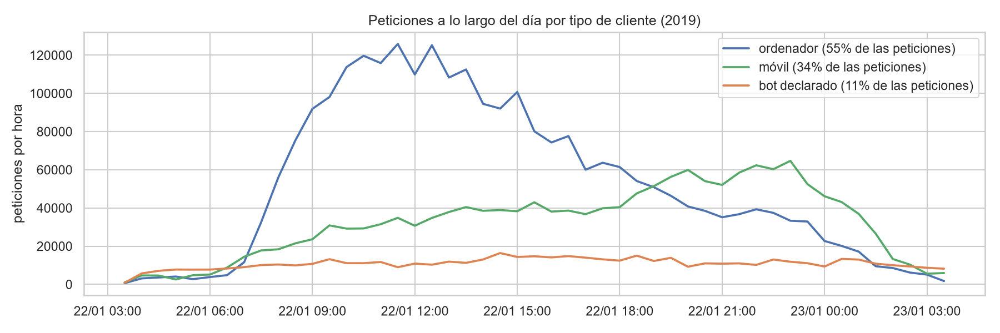
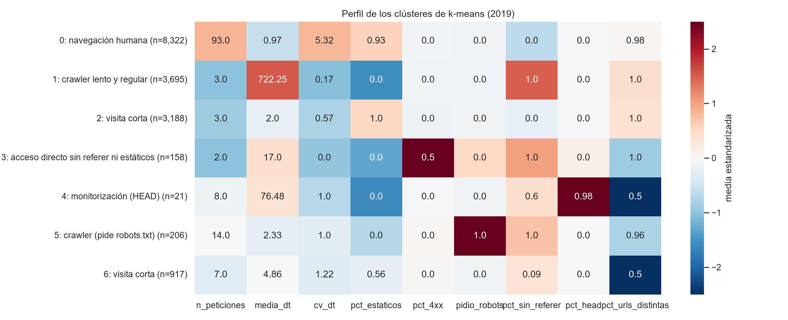

# Humanos frente a bots

**¿Se puede distinguir el tráfico humano del de los bots en una web solo por cómo se comportan las visitas?**

Este proyecto agrupa las sesiones de un log real de servidor web con aprendizaje no supervisado (k-means, DBSCAN y clustering aglomerativo) sin usar ninguna etiqueta. Solo al final se comprueba si los grupos coinciden con lo que cada visitante dice ser en su *user-agent*. Así aparecen los **bots camuflados**: programas que se presentan como un navegador normal pero se comportan como un bot.

Trabajo final de *Aprendizaje Automático I* (Máster en Inteligencia Artificial) · Celia Sáenz Villalta

---

## Por qué

Más de la mitad del tráfico web mundial ya lo generan bots, según los informes anuales de Imperva. Muchos se identifican (Googlebot, GPTBot, ClaudeBot…), pero los scrapers, los bots maliciosos y los agentes de IA que manejan un navegador envían el *user-agent* de un Chrome cualquiera, así que filtrar por esa cabecera no basta.

Trabajo automatizando flujos para IONOS, con programas que navegan por webs como si fueran usuarios. Este proyecto mira el problema desde el otro lado: qué delata a un programa cuando visita una web.

## Resultados en 30 segundos

| | |
|---|---|
| Datos | 24 h de una tienda online real: 2,34 M de peticiones → 80 423 sesiones → 16 507 sesiones de ordenador |
| Modelo | k-means con k = 7 sobre 9 variables de comportamiento (silhouette 0,522) |
| Validación | el **81,5 %** de los bots declarados caen en grupos automatizados, frente al **1,9 %** de los navegadores (ARI binario 0,744) |
| Bots camuflados | **229** sesiones con *user-agent* de navegador y comportamiento de bot |
| Generalización | aplicado al día siguiente sin reentrenar: 81,3 % de peticiones humanas, frente al 81,8 % del primer día |

## Cómo funciona

### 1. Del log a sesiones

Cada línea del log es una petición suelta (IP, fecha, URL, código, *referer*, *user-agent*), y una petición aislada no dice quién la hace. Por eso las peticiones se agrupan en **sesiones**: misma IP y mismo *user-agent*, con un corte tras 30 minutos sin actividad. Cada sesión se resume en 9 variables:

| Variable | Qué delata |
|---|---|
| número de peticiones | los bots hacen muchas en poco tiempo |
| tiempo medio entre peticiones y su coeficiente de variación | los programas son rápidos y muy regulares |
| % de recursos estáticos (CSS, JS, imágenes) | un navegador los carga, muchos bots no |
| % de peticiones sin *referer* | una persona llega siguiendo enlaces |
| % de errores 4xx | los escáneres prueban URLs que no existen |
| si pidió `robots.txt` | lo hacen sobre todo los crawlers |
| % de peticiones HEAD | típico de la monitorización |
| % de URLs distintas | los crawlers recorren páginas sin repetir |

El *user-agent* **no** se usa como variable: se reserva para validar. El estudio se centra en el tráfico de ordenador, que es lo que imitan los bots camuflados.

Ya en los datos en bruto se ve una diferencia: el tráfico humano sigue el ciclo del día y los bots mantienen el mismo ritmo de día y de noche.



### 2. Clustering

Tras una transformación logarítmica y la estandarización, k-means con k = 7 encuentra seis tipos de comportamiento (las visitas cortas salen en dos grupos):



- **Navegación humana:** muchas peticiones muy seguidas, carga recursos estáticos y siempre llega con *referer*.
- **Visitas cortas:** pocas peticiones, con estáticos y *referer*.
- **Crawler lento y regular:** una página cada 12 minutos, con una regularidad casi perfecta.
- **Crawlers que piden `robots.txt`**, **monitorización con HEAD** y **accesos directos con errores**: grupos pequeños con un perfil muy marcado.

DBSCAN y el clustering aglomerativo de Ward llegan a la misma estructura principal (ARI 0,84 con k-means).

### 3. Validación y bots camuflados

Al cruzar los grupos con el *user-agent*, el clustering separa bastante bien los dos tipos de tráfico sin haberlo visto nunca. Algunos de los bots camuflados encontrados:

- Un **«Chrome» en Windows 10** que empieza leyendo `robots.txt` y hace 691 peticiones en 376 s: una cada 0,54 s.
- Un **«Internet Explorer 5.01» en Windows 2000**, un navegador obsoleto desde hacía casi 20 años, que pide una página cada 19 s durante más de dos horas sin cargar ni un recurso estático. Al día siguiente vuelve desde la misma IP y el modelo lo detecta otra vez.

### 4. La herramienta: `analizar_log`

Todo el proceso queda en una función que recibe un log en formato *combined* de Apache y devuelve qué parte del tráfico de ordenador es humana, bot declarado, bot camuflado o ambigua, medida en sesiones y en peticiones:

```python
analizar_log("ruta/al/access.log")   # admite .gz, .zip y comodines para logs rotados
```

## Contenido del repositorio

| Archivo | Contenido |
|---|---|
| [`trabajo_bots_vs_humanos.ipynb`](trabajo_bots_vs_humanos.ipynb) | **Cuaderno principal:** parseo, sesiones, selección de variables, clustering, validación y `analizar_log` |
| [`analisis_dia2.ipynb`](analisis_dia2.ipynb) | Aplica el modelo guardado a las 24 h siguientes, sin reentrenar |
| [`comparacion_2025.ipynb`](comparacion_2025.ipynb) | Comparación con un log de 2025 (borrador, en revisión) |
| [`modelos/modelo_2019.pkl`](modelos/) | Modelo entrenado: escalador, k-means, nombres de los grupos y variables |
| [`figuras/`](figuras/) | Gráficos generados por los cuadernos |
| [`presentacion/presentacion.html`](presentacion/presentacion.html) | Diapositivas de la exposición de 5 minutos (descárgalo y ábrelo en el navegador) |

Los cuadernos se pueden leer directamente en GitHub con todas sus salidas y gráficos, sin ejecutar nada.

## Reproducirlo

Requisitos: Python 3 con `pandas`, `numpy`, `scikit-learn`, `matplotlib` y `seaborn`.

Los logs no están en el repositorio porque ocupan más de 1 GB. Hay que descargarlos en una carpeta `datos/`:

| Fichero | Fuente | Licencia |
|---|---|---|
| `zaker2019_kaggle.zip` | Zaker (2019), *Online Shopping Store – Web Server Logs*: [Kaggle](https://www.kaggle.com/datasets/eliasdabbas/web-server-access-logs) · [Harvard Dataverse](https://doi.org/10.7910/DVN/3QBYB5) | CC0 |
| `organization-x.zip` (solo para la comparación con 2025) | *Web Server Log Dataset* (2026): [Zenodo](https://doi.org/10.5281/zenodo.20001206) | MIT |

Después:

1. Ejecuta `trabajo_bots_vs_humanos.ipynb` (unos 4 minutos). Genera las figuras y guarda el modelo.
2. Ejecuta `analisis_dia2.ipynb`, que carga ese modelo. La primera vez extrae el segundo día del log a `datos/zaker2019_dia2.log`.

Las IPs se sustituyen por un *hash* al cargarlas, así que no aparecen en los cuadernos.

## Limitaciones

- La validación usa una etiqueta aproximada: un *user-agent* de navegador no garantiza que detrás haya una persona.
- Solo se estudia el tráfico de ordenador. Las sesiones móviles y las de una sola petición quedan fuera del clustering.
- El log de 2019 es anterior a la expansión de los crawlers y agentes de IA.
- Algunos bots, como BingPreview, se comportan igual que una visita humana breve y no se separan con estas variables.

Como siguientes pasos quedan probar el modelo con tráfico reciente y otras webs, verificar los bots declarados con sus rangos de IP publicados y añadir variables como la hora del día o la secuencia de páginas.

## Referencias

- Zaker, F. (2019). *Online Shopping Store – Web Server Logs*. Harvard Dataverse, V1. https://doi.org/10.7910/DVN/3QBYB5
- *Web Server Log Dataset* (2026). Zenodo. https://doi.org/10.5281/zenodo.20001206
- Imperva (Thales). *Bad Bot Report*, ediciones 2020–2026.
- Van Boxem et al. (2026). *Shy Guys: A Light-Weight Approach to Detecting Robots on Websites*. arXiv:2603.28546.
- *What Does It Take to Detect an AI Agent? Minimal Feature Sets for Behavioral Detection under Browser Automation* (2026). arXiv:2607.26935.
- *In-Application Defense Against Evasive Web Scans through Behavioral Analysis* (2024). arXiv:2412.07005.
- scikit-learn, documentación sobre clustering: https://scikit-learn.org/stable/modules/clustering.html
